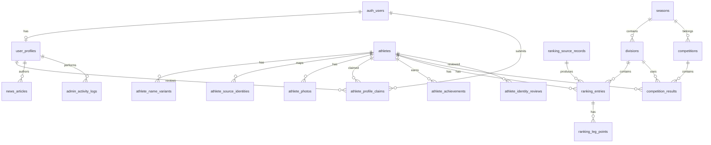

# UPSA Supabase Preparation

This folder contains database preparation drafts only. It does not connect to Supabase, execute SQL, seed data, create accounts, or change the public frontend.

## Scope

The prepared architecture covers:

- Supabase Auth identities and application roles
- Athlete profiles and identity-review records
- 2022-2026 ranking seasons, divisions, entries, leg points, and source records
- Future individual competition results
- Events and news
- Athlete achievements and profile claims
- Admin activity logs
- Row Level Security
- Supabase Storage layout

The existing `rankings-data.js`, athlete JavaScript, public pages, and CSS remain unchanged.

## Proposed structure

```text
supabase/
  migrations/
    20261119_001_initial_schema.sql
    20261119_002_rls_policies.sql
  seed/
    historical-ranking-audit.json
  scripts/
    import-historical-rankings.example.mjs
  README.md
```

## Create a Supabase project

1. Create a new Supabase project.
2. Select a region near the intended website users.
3. Store the project URL and anon key in deployment environment variables only.
4. Never place database passwords or service-role keys in this repository.
5. Enable email/password authentication.
6. Configure a supported site URL and redirect URLs later.
7. Review the migration drafts with the database administrator.
8. In a staging project, run only the SQL migration files approved for review.
9. Insert or verify the initial admin account and role through a controlled admin process.
10. Import the historical ranking source records through the repeatable script or a reviewed SQL/ETL process.
11. Compare imported counts and source hashes with the original JavaScript data.
12. Approve the data before production deployment.
13. Do not connect the public frontend until the migration and validation phases are complete.

## Database relationship diagram



`auth.users` remains separate from `public.athletes`. `user_profiles` is the application-level connection from an authenticated account to role and optional athlete identity.

## Core relationships

- One Supabase Auth user has zero or one application profile.
- An application profile may link to one athlete.
- An athlete may have many name variants and source identity mappings.
- A season has many divisions.
- A division belongs to one season.
- A ranking source record represents one original source row.
- One source record has one ranking entry.
- One ranking entry has many leg-point records.
- Competition results are separate from ranking entries and should not be inferred from leg points.
- One athlete may have many achievements and many competition results.
- Claims and identity reviews preserve unresolved or disputed mappings.

## Identity strategy

Source identity matching must preserve the existing frontend rules:

1. A verified source Athlete ID may create a source-identity mapping.
2. Mappings with one source name and no known conflict remain exact-ID candidates.
3. Exact-name matches may be provisional only when both source names normalize to the same name.
4. A source Athlete ID with multiple names in the same season/category remains conflicting and must not auto-merge.
5. Repeated source names within a division and season remain separate source rows or duplicate-name review cases.
6. Name-only rows from 2022-2024 must not be promoted to verified identities without independent review.
7. Manual identity review may create or update an athlete link, but must record reviewer, reason, evidence, and status.

## Storage layout

Use private-by-default objects and public read only for approved assets:

```text
athlete-photos/
  <athlete-uuid>/profile/
  <athlete-uuid>/cover/
events/
  <event-uuid>/
news/
  <article-uuid>/
```

Add file metadata in database tables rather than inferring ownership from filenames. Allow only verified administrator or permitted athlete profile operations to write. Do not copy random surfing stock photography into athlete folders.

Recommended buckets:

| Bucket | Public reads | Write access |
|---|---|---|
| `athlete-photos` | Verified public athlete photos | Admin; permitted linked player for their own profile |
| `event-images` | Published event images | Admin |
| `news-images` | Published news images | Admin |

Every upload should have a database record. Use size limits and MIME allowlists, such as JPEG, PNG, and WebP, before enabling public buckets. Add malware and moderation review for player uploads. Store original and optimized image versions only when the CDN/storage workflow requires them.

## Administrator assignment

Do not add public registration fields for role selection.

The initial administrator must be assigned through the Supabase SQL Editor or another service-role-only administrative process after confirming the Auth identity belongs to UPSA. The profile trigger creates every new Auth identity with `role = 'player'`.

An existing verified administrator may later assign another admin through a secure server-only function or SQL process. Never create an admin from a browser RPC that accepts a public user-selected role.

Recommended bootstrap:

1. Create the UPSA account through Supabase Auth.
2. Confirm the account UUID.
3. Update only that UUID to `role = 'admin'` while connected as the project owner or a database administrator.
4. Record the change in `admin_activity_logs`.
5. Test public, player, and admin requests in staging.
6. Remove temporary owner access after verification.

## File-by-file implementation plan

| File | Future role |
|---|---|
| `rankings-data.js` | Remains the public source until backend integration is approved |
| `athlete-data.js` | Later add a database-backed resolver behind the existing profile key API |
| `athletes.js` | Later replace reads only; keep existing search, season, division, and profile links |
| `athlete-profile.js` | Later fetch profile and ranking records; keep chart and identity presentation |
| `rankings.js` | Later fetch ranking entries while preserving table rendering and pagination |
| `events.html` / `script.js` | Later load published events behind the existing filter interface |
| `news.js` / `news.html` / `news-story.html` | Later migrate to published articles while preserving slugs and article URLs |
| `membership/membership.html` | Later connect claimed athlete identity and account flows only after authentication is approved |
| `supabase/migrations/` | Apply only after database review and staging validation |
| `supabase/seed/historical-ranking-audit.json` | Reference and validation seed inventory |
| `supabase/scripts/` | Repeatable source parser and migration validation |

## Later frontend integration

Keep current JavaScript data sources until backend integration is explicitly approved.

After approval:

1. Add a Supabase client only to pages selected for migration.
2. Create read-only repository functions for rankings and athlete profiles.
3. Keep the existing profile URL format working during transition.
4. Prefer server-verified or view-based public reads.
5. Feature a database source behind the existing frontend interfaces.
6. Preserve the current identity safeguards and name-only profile behavior.
7. Keep no service-role key in browser code.
